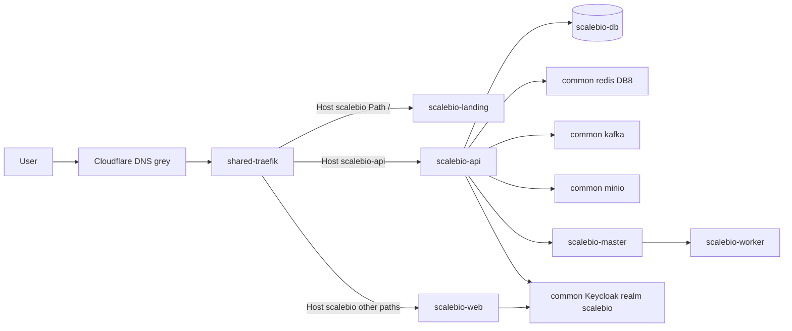

# MEP BioEngine (Mode B)

## Inputs figés

| Champ | Valeur |
| ----- | ------ |
| Nom commercial | **BioEngine** (tout le copy marketing / corporate / SEO) |
| Repo / images | ScaleBiometrics / `ghcr.io/.../scalebiometrics/{api,master,worker,web}` |
| Slug technique | `scalebio` (DNS, compose, secrets, VPS paths — inchangé) |
| Public | `https://scalebio.optimizesolux.com` |
| API | `https://scalebio-api.optimizesolux.com` |
| Auth | `https://auth.optimizesolux.com/realms/scalebio` |
| Redis | index **8**, prefix `scalebio:` |
| VPS | `169.58.127.90` / `/opt/scalebio` + `/opt/optimizesolux/scalebio-landing` |
| Contact affiché | `contact.bioengine@optimizesolux.com` (+ routing email à documenter) |

## Phase 1 — Landing (`landing-page/`)

Créer sous le repo ScaleBiometrics en miroir Elykia/eHealth, marque **BioEngine** :

- `landing-page/{index.html,css/styles.css,js/main.js,assets/,Dockerfile,docker-compose.yml,nginx.conf,.dockerignore,README.md}`
- Brand hero **BioEngine** (pas ScaleBiometrics) ; identité visuelle distincte (pas le teal Elykia) : biométrie / confiance / terrain — brand-first, motion (reveal, cursor-glow), `prefers-reduced-motion`
- Copy dirigeants/ops (déduplication identité, confiance, ROI) — **pas** jargon multi-tenant ni nom technique repo
- SEO / OG / JSON-LD : `name: BioEngine`, provider OptimizeSolux, canonical `scalebio.optimizesolux.com`
- FormSubmit + honeypot ; contact `contact.bioengine@optimizesolux.com`
- Traefik : `Host(scalebio.optimizesolux.com)` + `Path(\`/\`)` priority haute pour coexister avec la SPA
- Workflow [`.github/workflows/deploy-landing-page.yml`](.github/workflows/deploy-landing-page.yml) path-filtered (secrets `PROD_*` comme eHealth)

## Phase 2 — Corporate (`optimizesolux-web`)

Dans le sibling `../optimizesolux-web` :

1. Ajouter `app-card` **BioEngine** dans `#solutions` `.apps-stack` (comme BioCollect) : href `https://scalebio.optimizesolux.com`, pill Disponible, description captivante, 4 tags (ex. Biométrie, Déduplication, Identité, Terrain), CTA
2. Retirer `ScaleBiometrics` de `.coming-chips` (remplacé par la carte BioEngine)
3. JSON-LD Offer : `name: BioEngine`, `url`, description client
4. Lien footer Produits → BioEngine
5. [`docs/DNS-CONVENTION.md`](../optimizesolux-web/docs/DNS-CONVENTION.md) : catalogue peut noter produit « BioEngine » / slug `scalebio` ; A `scalebio` + `scalebio-api` dans la liste explicite
6. Meta keywords / SEO : remplacer ou compléter « ScaleBiometrics » par BioEngine où pertinent
7. Commit + push `main`, puis deploy Cloudflare Pages (`.deploy` + `wrangler pages deploy`)

## Phase 3 — Contabo full-app

### 3.1 `deploy/` (miroir eHealth scripts + CleanTrack dual-host)

Créer `[deploy/](deploy/)` :

| Fichier                                                          | Rôle                                                   |
| ---------------------------------------------------------------- | ------------------------------------------------------ |
| `docker-compose.prod.yml`                                        | postgres (`scalebio-db`) + api + master + worker + web |
| `init.sh` / `deploy.sh` / `setup-server.sh` / `update-deploy.sh` | bootstrap `/opt/scalebio`                              |
| `.env.prod.example`, `GITHUB-SECRETS-CONTABO.md`, `README.md`    | docs                                                   |

**Compose — règles dures :**

- Réseaux externes : `optimizesolux-common` + `traefik-public`
- **Pas** de redis / keycloak / kafka / minio / mailpit embarqués
- Traefik web : `Host(APP_HOSTNAME)` catch-all (paths app) ; landing garde `/`
- Traefik api : `Host(API_HOSTNAME)` → port **8081**
- master/worker : internes sur `optimizesolux-common` uniquement (gRPC)
- Env API : `REDIS_HOST=redis`, `REDIS_DATABASE=8`, `KAFKA_BOOTSTRAP_SERVERS=kafka:9092`, `MINIO_*` common, `KEYCLOAK_ISSUER_URI=https://auth.optimizesolux.com/realms/scalebio`, `DB_HOST=scalebio-db`, `MASTER_ADDRESS=scalebio-master:…`
- Web build-args / runtime : `NEXT_PUBLIC_API_URL=https://scalebio-api.optimizesolux.com/api`, OIDC public URLs vers realm `scalebio`

### 3.2 Keycloak + common-infra (hors compose produit)

- Préparer realm prod `scalebio` (à partir de `[infrastructure/keycloak/config/realm-export.json](infrastructure/keycloak/config/realm-export.json)`) : redirects `https://scalebio.optimizesolux.com/*`, clients `scalebio-web` / `scalebio-api`
- Documenter dépôt dans `optimize-common-infra/images/keycloak/realms/scalebio-realm.json` + rebuild Keycloak (étape manuelle VPS si pas de push common-infra dans ce MEP)
- Réserver Redis **8** dans skill/docs consumer ; documenter profil **kafka** activé sur common-infra

### 3.3 CD

- `[.github/workflows/cd.yml](.github/workflows/cd.yml)` : après CI success sur `release/**` + `workflow_dispatch` promote — SSH → `init.sh prod` avec 4 images GHCR (`api`,`master`,`worker`,`web`)
- Environnement GitHub `prod`
- Aligner noms de secrets sur eHealth : `PROD_SERVER_HOST/USER`, `SSH_PRIVATE_KEY`, `GHCR_*`, `DB_USER`, `PROD_DB_*`, `PROD_APP_HOSTNAME`, `PROD_API_HOSTNAME`, Redis password / JWT si besoin

### 3.4 Secrets + finish repo

Via `gh secret set` (PowerShell `Get-Content -Raw`) :

- Toujours : SSH key `~/.ssh/optimizesolux_vps_ed25519`, host `169.58.127.90`, user `root`, hostnames, DB, passwords RNG
- Manuel utilisateur : `GHCR_TOKEN` (non lisible depuis d’autres repos)
- Fichier hors git : `~/Documents/BioEngine-contabo-secrets.md` ; `.gitignore` `*-contabo-secrets.md`
- Commit + push repo ScaleBiometrics (landing + deploy + workflows) sur branche convenable (`main` pour landing path filter ; CD gate `release/**`)
- **Pas** de promote Contabo auto sauf demande

## Naming boundary

- **Public** : BioEngine partout (landing, carte corporate, JSON-LD, titres, emails affichés)
- **Technique** : slug `scalebio`, chemins VPS `/opt/scalebio*`, images `scalebiometrics/*`, realm Keycloak `scalebio` — pas de rename repo ni de nouveau host `bioengine.*` dans ce MEP

## Hors scope / next manuels

- DNS A grises `scalebio` + `scalebio-api` → Contabo (utilisateur)
- Email Routing Cloudflare pour `contact.bioengine@` (et alias) → forward habituel
- Import realm Keycloak common-infra + enable profile kafka si absent
- Premier `release/**` ou promote pour app live
- Consul : si l’API l’exige encore en prod, documenter contournement via adresses gRPC fixes (pas de nouvel outil dans common sauf nécessaire)
- Rename host `bioengine.optimizesolux.com` ou rename repo : hors MEP (demander explicitement)

